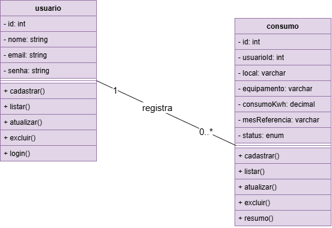

# Registro de Consumo de Energia

Projeto desenvolvido para a disciplina de Programação Back-End do curso Técnico em Desenvolvimento de Sistemas do SENAI.

O objetivo é desenvolver uma API REST para registrar e gerenciar o consumo de energia, utilizando Node.js, Express e MariaDB.

## Tecnologias utilizadas

- Node.js
- Express
- MariaDB
- MySQL
- Thunder Client
- Visual Studio Code

## Banco de Dados

O banco de dados utilizado no projeto é `gestao_consumo`, composto por duas tabelas:

- **usuario:** armazena os dados dos usuários.
- **consumo:** armazena os registros de consumo de energia.

O script de criação do banco de dados está disponível em `db/script.sql`.

## Funcionalidades

- Cadastro, listagem, atualização e exclusão de usuários.
- Login de usuários.
- Cadastro, listagem, atualização e exclusão de consumos.
- Consulta da média de consumo de energia em kWh.

## Rotas da API

| Método | Rota | Funcionalidade |
|---|---|---|
| GET | /usuarios | Listar usuários |
| POST | /usuarios | Cadastrar usuário |
| PUT | /usuarios/:id | Atualizar usuário |
| DELETE | /usuarios/:id | Excluir usuário |
| POST | /login | Realizar login |
| GET | /consumo | Listar consumos |
| POST | /consumo | Cadastrar consumo |
| PUT | /consumo/:id | Atualizar consumo |
| DELETE | /consumo/:id | Excluir consumo |
| GET | /consumo/resumo | Consultar média de consumo |

## Diagrama de Classes

## Testes da API

Os testes foram realizados utilizando o Thunder Client, verificando as operações de cadastro, consulta, atualização, exclusão, login e cálculo da média de consumo.

As imagens dos testes estão disponíveis na pasta `docs`.

## Como executar o projeto

1. Instale as dependências:

   `npm install`

2. Configure o banco de dados utilizando o arquivo `db/script.sql`.

3. Inicie o servidor:

   `npm run dev`

4. A API estará disponível em `http://localhost:3000`.
# sesi_pbe1_node_mariadb_consumo_2026
